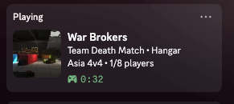

# War Brokers Discord Rich Presence (Steam)

Show your War Brokers match on your Discord profile: game mode, map (with the map picture), region, player count and time played.



Between matches it shows **In menu**, and it clears when you quit the game.

- One script (`wb_rpc.py`) plus an optional installer (`install.py`). Standard-library Python only, nothing to `pip install`.
- Starts and stops with the game through Steam launch options.
- No browser extension, no userscript, no server, no account.
- It only reads the game's log file. It doesn't touch game memory, game files or network traffic. The installer changes one Steam setting (War Brokers' launch option) and backs it up first.

## Platforms
| | Status |
|---|---|
| macOS | Tested |
| Windows | Working for a community tester (manual install, `python` launch command) |
| Linux (Flatpak Steam, Arch) | Working for a community tester (manual log path; automatic detection added since) |
| Linux (native or Proton) | Should work, not tested yet |

`install.py` is new: tested against copies of real Steam settings on macOS, not yet on a live Windows or Linux install. Reports are welcome.

## Supported servers
Every region on the War Brokers server list:

| Type | Regions |
|---|---|
| Classic | USA East, USA West, Europe, Asia, Japan, India, Australia, Russia |
| 4v4 | USA, Europe, Asia |
| Battle Royale | NA, Europe, Asia, Australia (shows lobby / in progress) |
| Dead City | NA, Europe, Asia |
| Clan | USA East, USA West, Europe, India, Australia |
| Competitive | NA |

## Requirements
- War Brokers on Steam
- Discord desktop app, running
- Python 3.9 or newer
  - macOS: already installed (`/usr/bin/python3`). If it asks to install developer tools, accept.
  - Windows: install from [python.org](https://www.python.org/downloads/)
  - Linux: usually already installed (`python3 --version` to check)

## Quick install

### Windows
1. **Install Python** (skip if you already have it): download it from [python.org](https://www.python.org/downloads/), run the installer and **tick "Add python.exe to PATH"** on the first screen before clicking Install.
2. **Quit Steam fully:** right-click the Steam icon in the taskbar tray (bottom-right, next to the clock; click the **^** arrow if you don't see it) → **Exit**. Just closing the window isn't enough.
3. **Open PowerShell:** press the **Windows key**, type `powershell`, press **Enter**. A blue or black window opens. No admin needed.
4. **Copy this line, then right-click inside the PowerShell window to paste it**, and press **Enter**:
   ```powershell
   irm https://raw.githubusercontent.com/prex-xo/war-brokers-discord-rpc/main/install.py -OutFile install.py; python install.py
   ```
5. When it says it's done, open Steam and press **Play** on War Brokers.

If it says `python` isn't recognized, or the Microsoft Store opens instead, Python isn't installed with "Add to PATH": redo step 1, then close and reopen PowerShell.

### macOS
1. **Quit Steam fully:** click Steam in the menu bar → **Quit Steam** (or press **Cmd+Q** in Steam).
2. **Open Terminal:** press **Cmd+Space**, type `terminal`, press **Enter**.
3. **Paste this line** (**Cmd+V**) and press **Enter**:
   ```bash
   curl -fsSL https://raw.githubusercontent.com/prex-xo/war-brokers-discord-rpc/main/install.py -o install.py && python3 install.py
   ```
   If macOS asks to install "command line developer tools", click **Install**, wait for it to finish, then paste the line again.
4. Open Steam and press **Play** on War Brokers.

### Linux
1. **Quit Steam fully** (Steam menu → **Exit**).
2. **Open a terminal** (often **Ctrl+Alt+T**), paste this line (**Ctrl+Shift+V**) and press **Enter**:
   ```bash
   curl -fsSL https://raw.githubusercontent.com/prex-xo/war-brokers-discord-rpc/main/install.py -o install.py && python3 install.py
   ```
3. Open Steam and press **Play** on War Brokers.

<details>
<summary>Prefer not to use a command line?</summary>

1. On this page, click **Code → Download ZIP** and unzip it.
2. Quit Steam fully.
3. Windows: double-click `install.py`. macOS / Linux: open a terminal in the unzipped folder and run `python3 install.py`.
4. Open Steam and press **Play**.
</details>

The installer:
- Puts `wb_rpc.py` in the game's own folder (`Trebuchet Entertainment LLC/wb-rpc`, next to the game's logs), so it isn't deleted by accident. With Flatpak Steam that folder is inside Steam's sandbox, which Flatpak Steam needs.
- Sets the War Brokers launch option in Steam for your Steam account. It only changes that one setting, backs up the settings file first (`localconfig.vdf.wb-rpc-backup`), and asks before replacing any launch options you already had.
- If Steam is still open or its settings can't be found, it shows the launch option to paste yourself (Steam → right-click War Brokers → Properties → Launch Options) and copies it to your clipboard.

Run it again any time to update. To install without touching Steam's settings: `python3 install.py --no-steam`.

## Manual install

1. Download `wb_rpc.py` and put it anywhere that it will stay. Below, `PATH/TO/wb_rpc.py` means wherever you saved it.
2. macOS / Linux only: make it runnable once:
   ```bash
   chmod +x PATH/TO/wb_rpc.py
   ```
3. In Steam, right-click **War Brokers** → **Properties** → **Launch Options**, and paste:

   **macOS / Linux**
   ```
   "PATH/TO/wb_rpc.py" %command%
   ```
   **Windows**
   ```
   python "PATH\TO\wb_rpc.py" %command%
   ```
   Use `python` (or `python3`, whichever works in your Command Prompt). `pyw` isn't always installed, and `py` works too if you have the Python launcher. A console window stays open while you play.
   Replace `PATH/TO` with the full path to where you saved the file (e.g. `/home/you/wb_rpc.py`). On macOS the line must start with the file path, not `python3`; otherwise Steam fails with *OS Error 260*.
4. Press **Play**.

## Uninstall
1. Clear War Brokers' launch options in Steam (right-click → Properties → Launch Options).
2. Delete the `wb-rpc` folder (from the installer) or wherever you saved `wb_rpc.py`.

### Without launch options
Start the game normally, then run:
```bash
python3 wb_rpc.py
```
It watches the running game until you press Ctrl+C.

## How it works
Unity writes the game's log to `Player.log`. The script follows that file:

| Log line | Meaning |
|---|---|
| `Setting last location to ASIA_4V4` | last region tab picked (only a hint; the real region is found by IP) |
| `openSocketAndConnect - wss://45-32-31-106.warbrokers.io/...` | server IP |
| `Loading scene 33` | map (`-1` = left the match) |
| `External Call: serverMenuOpen();` | back in the menu |
| `webguy.OnDestroy` | game closed |

Region, game mode and player count come from the public War Brokers server list:

- **On each server join**, every region is searched for the server's IP. The game's "last location" line is not trusted, because it's only the region tab you last picked (it can say `ASIA_4V4` while you're on an EU server).
- **Several servers can share an IP** (for example a clan server and a public server), so it picks the one running the map you loaded. The region tab is only used to break a tie.
- **Once confirmed**, only that one region is re-checked every 30 seconds for player count and mode. Joining another server starts a fresh search.

Log locations:
- macOS: `~/Library/Logs/Trebuchet Entertainment LLC/War_Brokers/Player.log`
- Windows: `%USERPROFILE%\AppData\LocalLow\Trebuchet Entertainment LLC\War_Brokers\Player.log`
- Linux: `~/.config/unity3d/Trebuchet Entertainment LLC/War_Brokers/Player.log`
- Linux, Flatpak Steam: `~/.var/app/com.valvesoftware.Steam/.config/unity3d/Trebuchet Entertainment LLC/War_Brokers/Player.log`
- Linux, Snap Steam: `~/snap/steam/common/.config/unity3d/Trebuchet Entertainment LLC/War_Brokers/Player.log`
- Linux with Proton: inside `steamapps/compatdata/750470/pfx/drive_c/users/steamuser/AppData/LocalLow/...`

The script checks these automatically (and, on Linux, searches `.var`, `snap`, `.local`, `.steam` and `.config` if none match) and uses the newest log. If it still can't find it, see below.

## Troubleshooting
- **Installer says Steam is open:** quit Steam fully (Steam menu → Exit/Quit, not just closing the window), then press Enter. Or type `s` to skip and paste the launch option it shows you.
- **Installer couldn't set the launch option** (Steam not found, or the setting looked unusual): it prints the line to paste instead. Nothing was changed.
- **Undo the installer's Steam change:** with Steam closed, replace `localconfig.vdf` with `localconfig.vdf.wb-rpc-backup` in the same folder (`Steam/userdata/<your id>/config/`), or just clear the launch options in Steam.
- **Steam shows "OS Error 260" (macOS):** the launch option must start with the quoted path to `wb_rpc.py`, not with `python3`. Run the installer again, or fix it by hand.
- **"Can't find the game's Player.log" in `wb_rpc.log`, or it never reacts to the game:** find the log yourself and tell the script where it is. Linux/macOS:
  ```bash
  find ~ -type d -name "Trebuchet Entertainment LLC" 2>/dev/null
  ```
  Then set `PLAYER_LOG_PATH` near the top of `wb_rpc.py` to `<that folder>/War_Brokers/Player.log`. You can also set the `WB_RPC_LOG` environment variable instead.
- **Nothing on Discord:** Discord must be the desktop app and already open. Check *Settings → Activity Privacy → Share your detected activities* is on.
- **Debug output:** see `wb_rpc.log`, saved in the `Trebuchet Entertainment LLC` folder next to the game's own logs (next to the script if that folder isn't found). It's recreated on every launch and includes your Steam username, so check it before posting it in an issue.
- **Player count shows 0, or no region for a moment:** the server list updates a few seconds behind the game; it corrects itself on the next check (up to 30 seconds).
- **Clan server shown as the public region:** a clan server and a public server can share an IP. If both are on the same map, the script can't tell them apart and follows the region tab you picked.
- **Linux, Discord installed as Flatpak or Snap:** the script looks for Discord's socket in those locations too. With Flatpak Steam, the sandbox may need access to Discord's socket (for example with Flatseal, allow `xdg-run/app/com.discordapp.Discord`). If it still can't connect, check `wb_rpc.log`.

## Using your own Discord application
The script ships with a Discord application ID named "War Brokers". Application IDs aren't secret. To use your own, create one at <https://discord.com/developers/applications> and put its **Application ID** in `CLIENT_ID` at the top of `wb_rpc.py`. The application's name is what Discord shows after "Playing".

## Credits
- Map and mode names: [War-Brokers/War-Brokers](https://github.com/War-Brokers/War-Brokers) (`libs/wb-types`)
- Map pictures: [War Brokers Wiki](https://war-brokers.fandom.com)

Not affiliated with Trebuchet Entertainment or War Brokers.

## License
MIT
